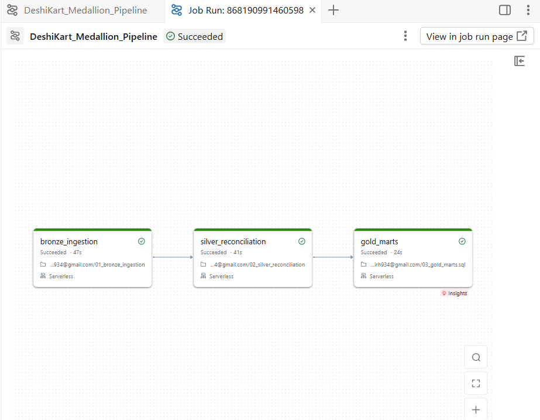
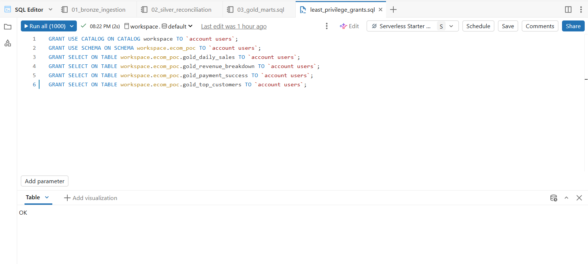
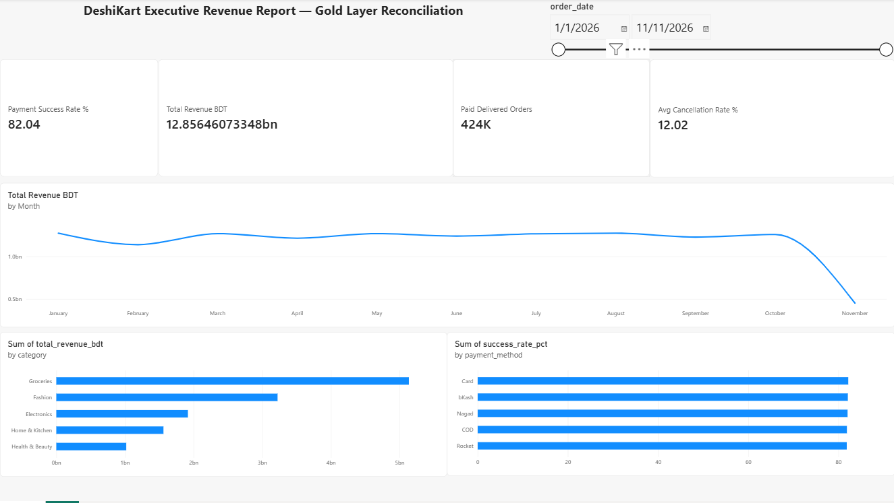

# 🛒 DeshiKart E-Commerce Lakehouse & BI Analytics Platform

End-to-end Medallion Lakehouse pipeline, automated Lakeflow orchestration, Unity Catalog least-privilege governance, AI/BI Genie validation, and cross-tool Power BI reconciliation built on **Databricks** and **Power BI Desktop**.

---

## 🏗️ Architecture & Medallion Data Flow

```text
Synthetic E-Commerce Generator (deshikart_raw_csvs/generator/generate_deshikart_data.py)
       │
       ▼  Raw CSVs (/Volumes/workspace/ecom_poc/raw_files)
┌─────────────────────────────────────────────────────────────┐
│ BRONZE LAYER — 01_bronze_ingestion.ipynb                    │
│ • Schema-on-read (all STRING) + lineage metadata            │
│ • Raw orders & payment logs with batch_id & ingestion_ts    │
└─────────────────────────────────────────────────────────────┘
       │
       ▼
┌─────────────────────────────────────────────────────────────┐
│ SILVER LAYER — 02_silver_reconciliation.ipynb               │
│ • Deduplication, strict type casting & data quality rules   │
│ • Order-to-payment reconciliation across 1M+ records        │
└─────────────────────────────────────────────────────────────┘
       │
       ▼
┌─────────────────────────────────────────────────────────────┐
│ GOLD LAYER — 03_gold_marts.sql.ipynb                        │
│ • gold_daily_sales         • gold_revenue_breakdown         │
│ • gold_payment_success     • gold_top_customers             │
└─────────────────────────────────────────────────────────────┘
       │
       ├──────────────────────────┬───────────────────────────┐
       ▼                          ▼                           ▼
 Databricks AI/BI          Genie Space Agent           Power BI Desktop
 (Executive Dashboard)     (Natural Language SQL)      (Import Mode + DAX)
```

---

## 📂 Repository Structure

```text
deshikart-lakehouse-analytics/
├── .gitignore
├── README.md
├── deshikart_raw_csvs/
│   └── generator/
│       └── generate_deshikart_data.py
├── notebooks/
│   ├── 01_bronze_ingestion.ipynb
│   ├── 02_silver_reconciliation.ipynb
│   └── 03_gold_marts.sql.ipynb
├── sql/
│   └── least_privilege_grants.sql
├── dashboards/
│   └── genie_validation.png
├── powerbi/
│   ├── deshikart_report.pbix
│   ├── pbi_connection.png
│   └── powerbi_report.png
└── operations/
    ├── lakeflow_job_run.png
    ├── least_privilege_grants.png
    └── trial_credits_cleanup.png
```

---

## 📊 Cross-Tool Metric Reconciliation

All Gold metrics were independently reconciled across **Databricks SQL**, **Databricks Genie AI**, and **Power BI Desktop (DAX)** with zero variance:

| Business Metric | Databricks SQL / Gold Table | Genie AI Agent | Power BI Desktop (DAX) | Variance |
| :--- | :---: | :---: | :---: | :---: |
| **Total Net Revenue (BDT)** | `12,856,460,733.48` | `12,856,460,733.48` | `12,856,460,733.48` | `0.00%` |
| **Paid Delivered Orders** | `423,714` | `423,714` | `423,714` | `0.00%` |
| **Top Revenue Category** | `Groceries` (`5,135,849,564.82` BDT) | `Groceries` (`5,135,849,564.82` BDT) | `Groceries` (`5.14B` BDT) | `0.00%` |
| **Average Cancellation Rate** | `12.02%` | `12.02%` | `12.02%` | `0.00%` |
| **Overall Payment Success Rate** | `82.04%` | `82.04%` | `82.04%` | `0.00%` |

### Payment Method Success Ranking (`gold_payment_success`)
1. **Card:** `82.17%`
2. **bKash:** `82.08%`
3. **Nagad:** `82.02%`
4. **COD:** `81.87%`
5. **Rocket:** `81.84%`

---

## ⚙️ Lakeflow Orchestration & Reliability

Orchestrated via **`DeshiKart_Medallion_Pipeline`** (Job Run `868190991460598`) on Serverless Compute:
* **Sequential DAG:** `bronze_ingestion` (47s) → `silver_reconciliation` (41s) → `gold_marts` (24s)
* **Fault Tolerance:** `max_retries: 1` configured per task with automated failure email notifications.



---

## 🔐 Unity Catalog Least-Privilege Governance

BI consumers (`account users`) are restricted strictly to read-only `SELECT` privileges on the four Gold marts—preventing direct access to raw Bronze ingestion tables or intermediate Silver records (`sql/least_privilege_grants.sql`):

```sql
GRANT USE CATALOG ON CATALOG workspace TO `account users`;
GRANT USE SCHEMA ON SCHEMA workspace.ecom_poc TO `account users`;
GRANT SELECT ON TABLE workspace.ecom_poc.gold_daily_sales TO `account users`;
GRANT SELECT ON TABLE workspace.ecom_poc.gold_revenue_breakdown TO `account users`;
GRANT SELECT ON TABLE workspace.ecom_poc.gold_payment_success TO `account users`;
GRANT SELECT ON TABLE workspace.ecom_poc.gold_top_customers TO `account users`;
```



---

## 📈 Power BI Executive Report & DAX Measures

Connected to Databricks SQL Warehouse via **Import Mode** (`powerbi/deshikart_report.pbix`) so executive dashboards remain responsive and self-contained even when compute is stopped:

```dax
Total Revenue BDT = SUM(gold_daily_sales[net_revenue_bdt])
Paid Delivered Orders = SUM(gold_daily_sales[paid_delivered_orders])
Avg Cancellation Rate % = AVERAGE(gold_daily_sales[cancellation_rate_pct])
Payment Success Rate % = DIVIDE(SUM(gold_payment_success[successful_txns]), SUM(gold_payment_success[total_attempts]), 0) * 100
```



---

## 🤖 AI/BI Genie Validation

Validated natural-language-to-SQL accuracy against the Gold layer across revenue totals, category rankings, and payment conversion rates.


---

## 🧹 FinOps & Trial Resource Cleanup

* SQL Warehouse stopped immediately after Power BI import and validation.
* Recurring job schedules disabled on `DeshiKart_Medallion_Pipeline` to prevent idle compute burn.


---

## 👤 Author
**Tanvir Hasanat** — [GitHub (@tanvirh47)](https://github.com/tanvirh47)
